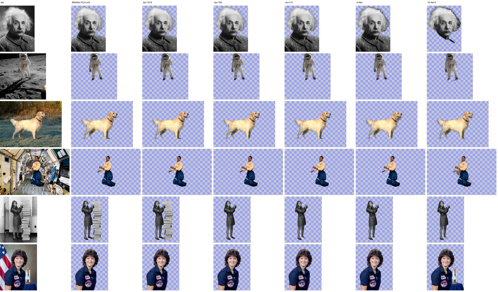
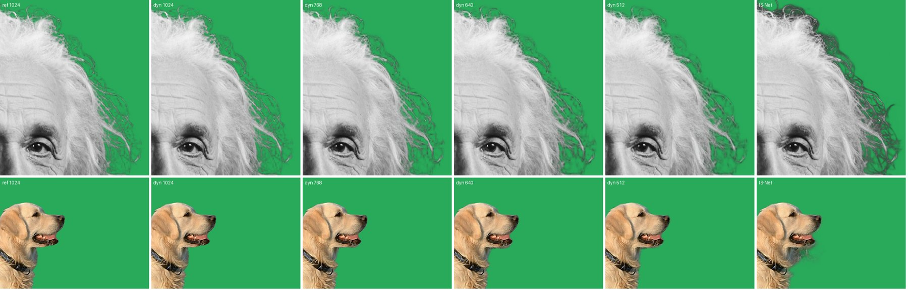

# Laporan Spike S3b — Model Cutout Hemat Memori

> **Status:** Selesai (21 Okt 2026) di Windows Sandbox, RTX 5070 Ti (GPU-PV). iGPU dan laptop belum diuji.
> **Lanjutan dari:** [Laporan S3](S3-report.md) §3.3 · **Keputusan:** [ADR-0006](../adr/0006-local-ai-runtime.md) §7 (diperbarui) · **Kode:** [`spikes/s3-ai/`](../../spikes/s3-ai/README.md)
> **Rekomendasi:** ✅ **BiRefNet-lite, export dinamis (DeformConv native)** sebagai model cutout default.
> Hasilnya **identik** dengan export standar di 1024² dengan **2,4 GB VRAM** (sebelumnya 11,1 GB), dan memenuhi target CPU ≤ 2 GB pada 768² (1,0 GB).
> IS-Net menjadi mode "cepat" untuk video. U²-Net-P ditolak.

## 1. Ringkasan

| Target (P0-09b) | Hasil | Status |
|---|---|---|
| ≤ 3 GB VRAM | BiRefNet-dyn 1024²: **2,42 GB**; 768²: 1,92 GB; IS-Net: 1,06 GB | ✅ |
| ≤ 2 GB RAM di CPU | BiRefNet-dyn 768² arena mati: **1,03 GB**; 512²: 0,66 GB; IS-Net: 0,83 GB | ✅ |
| Kualitas mendekati BiRefNet standar | BiRefNet-dyn 1024²: IoU **0,9985**, MAE alfa 0,0005 (identik); 768²: IoU 0,9875 | ✅ |
| Kecepatan | ⚠️ BiRefNet-dyn di DirectML **0,92 dtk/frame** (1024²), dibanding 97 ms export standar. DeformConv kemungkinan jatuh ke CPU | ⚠️ → tindak lanjut |

## 2. Kandidat & metode

**Kandidat** (dipin di [`models/manifest.toml`](../../models/manifest.toml)):

| Kandidat | Sumber · lisensi | Input |
|---|---|---|
| **BiRefNet-lite export dinamis** | `senty-au/BiRefNet_lite-ONNX-dynamic` (commit `173d635`), bobot `ZhengPeng7/BiRefNet_lite` tanpa perubahan · MIT | Opset 19 dengan `DeformConv` native (bukan rantai `GatherND`). H/W kelipatan 64, keluaran logit |
| IS-Net general-use | Konversi rembg (MIT), bobot DIS · Apache-2.0. MD5 dari kode rembg dicocokkan, lalu SHA-256 dipin | 1024², mean 0,5 / std 1,0, keluaran min-max |
| U²-Net-P (4,6 MB) | rembg · Apache-2.0 | 320². Batas bawah kualitas |
| ~~RMBG-1.4 / 2.0 (BRIA)~~ | Lisensi non-komersial | Ditolak tanpa diuji |

**Referensi kualitas:** export standar BiRefNet-lite fp16 1024² di DirectML. Export ini cocok dengan PyTorch, dan dipilih karena matting rambutnya terbaik di S3.

**Data uji:** 6 foto public-domain di `tests/media/s3/img` (sumber di `SOURCES.json`):

| Foto | Kasus sulit |
|---|---|
| Einstein | Rambut halus |
| Aldrin | Seluruh tubuh, latar bulan |
| Golden retriever | Bulu |
| Mae Jemison | Latar kabin yang ramai |
| Margaret Hamilton | Orang + tumpukan buku |
| Sally Ride | Potret studio + bendera dan model roket |

**Metrik** (pada grid sisi terpanjang 1024 px):
- IoU (alfa ≥ 0,5);
- MAE alfa;
- **MAE tepi**: MAE dalam pita ±8 px di sekitar kontur referensi, tempat rambut dan bulu berbeda.

**Memori** diukur per konfigurasi, satu proses per konfigurasi, dengan sampler yang sama seperti S3. GPU di-warm-up dulu (1 inferensi), lalu 3 putaran × 6 gambar; CPU 1 putaran.

## 3. Hasil

Rata-rata 5 gambar. Hamilton dipisah (lihat §3.1).

| Konfigurasi | ms/frame | RAM puncak | VRAM puncak | IoU | MAE | MAE tepi |
|---|---|---|---|---|---|---|
| Referensi: BiRefNet standar fp16 · DML | **97** | 0,63 GB | **11,08 GB** | — | — | — |
| **BiRefNet-dyn 1024 · DML** | 919 | 1,56 GB | **2,42 GB** | **0,9985** | 0,0005 | **0,006** |
| BiRefNet-dyn 768 · DML | 530 | 1,10 GB | 1,92 GB | 0,9875 | 0,0034 | 0,043 |
| BiRefNet-dyn 640 · DML | 390 | 0,91 GB | 1,39 GB | 0,9851 | 0,0045 | 0,054 |
| BiRefNet-dyn 512 · DML | 279 | 0,77 GB | 0,82 GB | 0,9801 | 0,0053 | 0,069 |
| BiRefNet-dyn 1024 · CPU | 2.919 | 2,79 GB | — | 0,9985 | 0,0005 | 0,006 |
| BiRefNet-dyn 768 · CPU | 1.573 | 2,35 GB | — | 0,9875 | 0,0034 | 0,043 |
| **BiRefNet-dyn 768 · CPU, arena mati** | 2.460 | **1,03 GB** | — | 0,9875 | 0,0034 | 0,043 |
| BiRefNet-dyn 512 · CPU | 710 | 0,96 GB | — | 0,9801 | 0,0053 | 0,069 |
| BiRefNet-dyn 512 · CPU, arena mati | 1.146 | 0,66 GB | — | 0,9801 | 0,0053 | 0,069 |
| **IS-Net · DML** | **49** | 0,51 GB | 1,06 GB | 0,9769 | 0,0103 | 0,097 |
| IS-Net · CPU | 532 | 1,57 GB | — | 0,9769 | 0,0103 | 0,097 |
| IS-Net · CPU, arena mati | 600 | 0,83 GB | — | 0,9769 | 0,0103 | 0,097 |
| U²-Net-P · DML | 4 | 0,36 GB | 0,36 GB | 0,8250 | 0,1022 | 0,200 |
| U²-Net-P · CPU | 67 | 0,60 GB | — | 0,8250 | 0,1022 | 0,200 |

Pembanding dari S3: export standar di CPU butuh 11,9 GB RAM (fp32), dan fp16 gagal.





### 3.1 Pengamatan visual
- **BiRefNet-dyn 1024** tidak bisa dibedakan dari referensi.
- **768** kehilangan sebagian helai rambut terhalus (ujung rambut Einstein), tetapi tepinya bersih tanpa halo. **512** kehilangan lebih banyak helai.
- **IS-Net:**
  - mempertahankan banyak rambut, tetapi meninggalkan **pinggiran gelap dari latar** (halo);
  - latar bocor di bawah dagu anjing;
  - ada lubang di rambut Einstein (IoU 0,948).
- **U²-Net-P** gagal di Einstein (tubuh hilang, IoU 0,505) dan ikut memotong model roket di foto Sally Ride → **ditolak**.
- **Hamilton** adalah ambiguitas semantik, bukan galat. BiRefNet 1024 menganggap tumpukan buku sebagai foreground, sedangkan semua model lain (termasuk BiRefNet ≤ 768) hanya memotong orangnya (IoU ≈ 0,45 untuk semuanya). Produk perlu kontrol "subjek" (klik untuk menambah atau membuang objek, Fase 1/2).

## 4. Temuan
1. **Masalah memori di S3 berasal dari cara export, bukan dari modelnya.** Bobot yang sama, diekspor dengan `DeformConv` native, turun dari 11,1 GB ke 2,4 GB VRAM dan dari 11,9 GB ke 2,8 GB RAM, dengan keluaran identik (IoU 0,9985).
2. **DirectML kemungkinan tidak menjalankan `DeformConv`.**
   - Bukti tidak langsung: DML hanya 3,2× lebih cepat daripada CPU (919 vs 2.919 ms), padahal export standar ±58× lebih cepat di DML (fp32 CPU 5,7 dtk vs fp16 DML 97 ms). Working set juga naik ke 1,56 GB di mode DML.
   - Dugaan: node DeformConv dijalankan CPU EP dengan salinan tensor GPU↔CPU di setiap lapisan.
   - Belum diverifikasi lewat log penempatan node ORT.
3. **Arena ORT menggandakan memori CPU** (768²: 2,35 → 1,03 GB) dengan biaya ±55% lebih lambat. Untuk perangkat ≤ 8 GB RAM, arena dimatikan.
4. **Ambiguitas subjek** (Hamilton) membutuhkan UI koreksi, bukan model yang lebih besar.
5. **Stabilitas temporal pada video belum diuji.** Semua metrik di sini per gambar. Kedipan tepi antar-frame harus diukur di Fase 1 (uji klip pendek + perataan temporal alfa).

## 5. Rekomendasi (diterapkan ke ADR-0006 §7)

| Perangkat | Foto / frame diam | Video (pekerjaan latar) |
|---|---|---|
| GPU dengan VRAM ≥ 12 GB | BiRefNet standar fp16 (97 ms) | BiRefNet standar fp16 (97 ms/frame) |
| GPU dengan VRAM 3–12 GB | **BiRefNet-dyn 1024** (2,4 GB, ±0,9 dtk) | "Kualitas": BiRefNet-dyn 768 (0,53 dtk/frame) · "Cepat": IS-Net (49 ms/frame) |
| GPU < 3 GB / iGPU | BiRefNet-dyn 512–640 | IS-Net (1,06 GB VRAM) |
| CPU saja | BiRefNet-dyn 768, arena mati (1,0 GB, ±2,5 dtk) | IS-Net, arena mati (0,8 GB, 0,6 dtk/frame) |

**Tindak lanjut:**
- **(a)** Verifikasi penempatan DeformConv di DirectML, lalu uji export varian `GridSample` (ukuran tetap) atau DeformConv fp16 agar BiRefNet hemat memori juga cepat di GPU. Targetnya ≤ 200 ms/frame pada 1024².
- **(b)** Ukur stabilitas temporal pada video.
- **(c)** Validasi di iGPU dan laptop 8 GB.
- **(d)** Export dinamis berasal dari pihak ketiga. Sebelum rilis, Kinora mengekspornya sendiri dari bobot resmi di CI (skrip export dipin), agar asal file dapat dibuktikan.

## 6. Reproduksi
Satu sesi Sandbox dengan 16 tugas (satu konfigurasi per proses). Referensi dijalankan pertama.

```
models birefnet-lite-dyn,isnet-general,u2netp
bench cutout --model birefnet-lite-fp16 --device dml --tag ref
bench cutout --model birefnet-lite-dyn --size {1024,768,640,512} --device dml --tag dyn<size>-dml
bench cutout --model birefnet-lite-dyn --size {1024,768,512} --device cpu [--lean] --tag ...
bench cutout --model {isnet-general,u2netp} --device {dml,cpu} [--lean] --tag ...
```

Masker per konfigurasi: `tests/media/s3-out/cutout/<konfigurasi>/<gambar>.png`. Laporan mentah: `tests/media/s3-out/runs/s3b/`.
